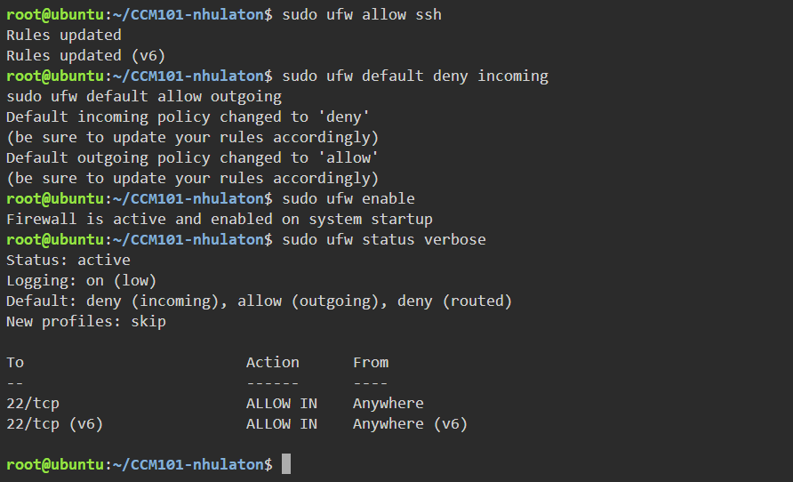
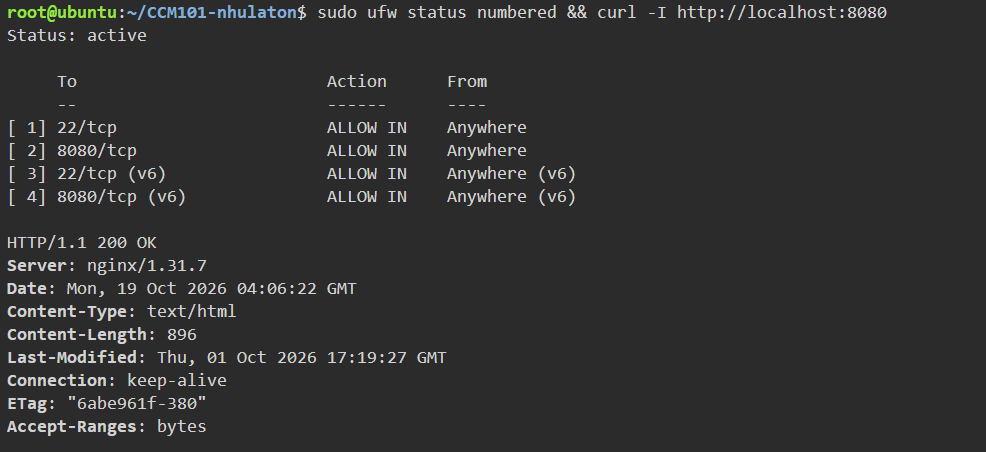

# Firewall Configuration

## Technical Documentation

UFW (Uncomplicated Firewall) was used to secure the Ubuntu server running the `secure-web-app` Nginx container.

### 1. Allow SSH

    sudo ufw allow ssh

Keeps port 22 open so administrators can still manage the server.

### 2. Set the Default Deny Policy

    sudo ufw default deny incoming
    sudo ufw default allow outgoing

Blocks all incoming traffic by default while still allowing the server to make outgoing connections.

### 3. Allow Port 8080

    sudo ufw allow 8080/tcp

Opens only the TCP port used by the web application.

### 4. Enable and Verify

    sudo ufw enable
    sudo ufw status verbose
    sudo ufw status numbered
    curl -I http://localhost:8080

### Warning: Enabling UFW Before Allowing SSH
If `sudo ufw enable` were run before `sudo ufw allow ssh`, the default deny policy would block port 22 and lock the administrator out of the server.

### Screenshots

Firewall activated with default deny policy:

Port 8080 allowed and web app reachable:

